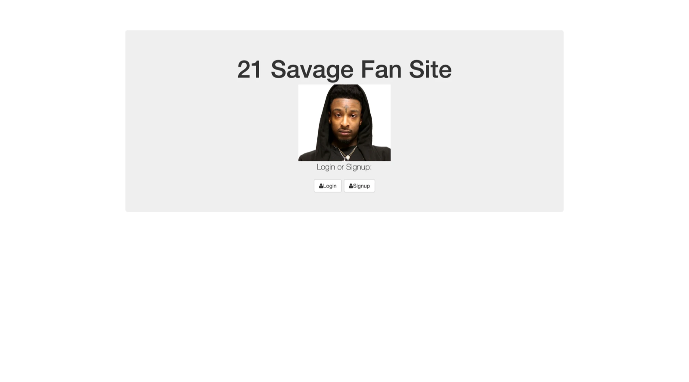

# 21 Savage Fan Site 🎤

A fan site where you can sign up, log in, and post messages on a message board that you can like, dislike, and delete.

## Description

This is a full stack app I made to practice logging users in. You make an account with an email and password, and once you're logged in you get a profile page with a message board. You can add a message, give any message a thumbs up or a thumbs down, and delete messages. I built it with Node, Express, MongoDB, and Passport, and I used `fetch` on the page to talk to the server for the likes and deletes.

## Screenshots

**Home page:** where you choose to log in or sign up.




## Features

- Sign up and log in with an email and password
- Passwords are hashed with bcrypt before they are saved
- Stay logged in with sessions, and log out with the Logout button
- Profile page that only logged in users can see
- Add a message to the message board
- Thumbs up and thumbs down buttons that keep count of each
- Trash can button to delete a message
- Flash messages that tell you if your login or sign up didn't work (like "Oops! Wrong password.")

## Tech Used

- HTML
- CSS
- Bootstrap
- JavaScript
- Node.js
- Express
- MongoDB with Mongoose
- EJS
- Passport (passport-local)
- bcrypt-nodejs

## How to Use

This app needs [Node.js](https://nodejs.org) and a MongoDB database (I used a free MongoDB Atlas cluster).

1. Download or clone the project, then open the folder in your terminal.
2. Install the packages:
   ```
   npm install
   ```
3. Make a file called `config/database.js` and add your own MongoDB connection string. This file is in `.gitignore` so it doesn't go on GitHub.
   ```js
   module.exports = {
       'url' : 'your MongoDB connection string here',
       'dbName': 'demo'
   };
   ```
4. Start the server:
   ```
   node server.js
   ```
5. Open your browser and go to `localhost:8080`.
6. Click **Signup** and make an account. You will land on your profile page.
7. Type a message in the box and click **Submit** to add it to the board.
8. Click the thumbs up or thumbs down to vote on a message, or the trash can to delete it.
9. Click **Logout** when you're done.
10. To stop the server, press Ctrl + C in the terminal.

## How It Works

1. When you sign up or log in, Passport checks your email and password against the users in MongoDB. The password is hashed with bcrypt, so the real password is never saved.
2. If it works, Passport starts a session so the server remembers you, and sends you to your profile page. If you aren't logged in, the profile page sends you back to the home page.
3. The profile page gets all the messages from MongoDB and shows them with EJS.
4. When you click a thumbs up, thumbs down, or trash can, `main.js` grabs that message's name and text and sends them to the server with `fetch`. The server updates or deletes the message in MongoDB, then the page reloads to show the change.

The message board uses the CRUD routes from class:

| Action | Method | Route |
|---|---|---|
| Create a message | POST | `/messages` |
| Read messages | GET | `/profile` |
| Update thumbs up | PUT | `/messages` |
| Update thumbs down | PUT | `/messages/thumbDown` |
| Delete a message | DELETE | `/messages` |

## What I Learned

- How to set up sign up and log in with Passport
- How sessions keep a user logged in
- Why passwords should be hashed and never saved as plain text
- How to keep my database link out of GitHub
- How to use `fetch` to send PUT and DELETE requests to my server
- How to read data from MongoDB and show it on a page with EJS
- How to add a new feature (the thumbs down) to code that was already working

VIEW APP HERE: https://savage-auth-yuqc.onrender.com/

## Author

Maya Rose 🌹
